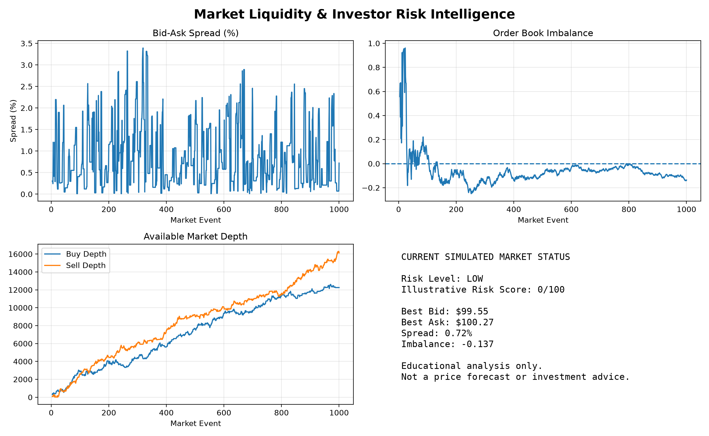
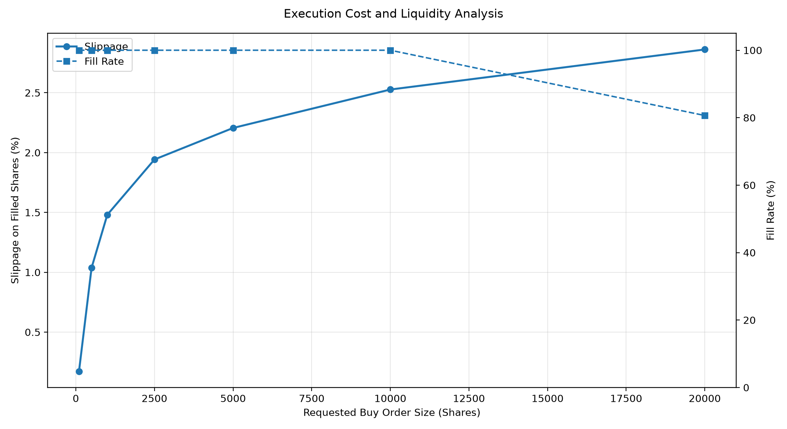
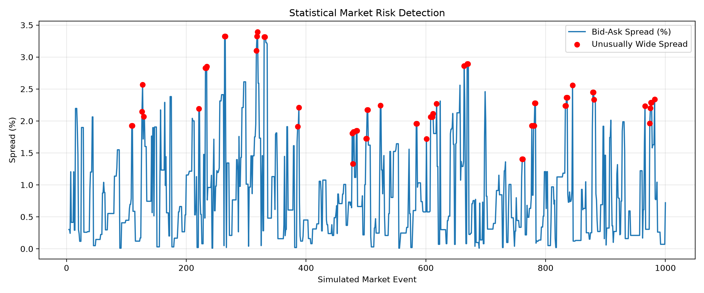

# Market Liquidity & Investment Risk Intelligence Engine

**C++17 | Python | Market Microstructure | Quantitative Analysis | Risk Intelligence**

A quantitative market simulation and analysis system that examines how trading activity affects market liquidity, execution costs, and investment risk.

The project combines a C++17 order-matching engine with Python-based statistical analysis to help explain market conditions through accessible visualizations and risk indicators.

## Why I Built This

Investors often focus on whether stock prices are rising or falling, but price movement alone does not tell the full story.

For example, an investor may want to purchase 10,000 shares at $100. However, if only 2,000 shares are available at that price, the remaining order may need to execute at higher prices or remain unfilled.

This creates additional trading costs, known as **execution slippage**.

I built this project to explore how market liquidity affects trading decisions and how complex financial information can be translated into useful insights, particularly for investors who may not have the time or technical background to analyze market data themselves.

## How the System Works

The project consists of three main components:

### 1. C++ Market Simulation Engine

The C++17 engine simulates a financial market by generating buy and sell orders.

It maintains a **limit order book**, which records the prices and quantities at which market participants are willing to buy or sell.

The engine supports:

- Buy and sell limit orders
- Price-time priority matching
- Partial order executions
- Order cancellation
- Trade recording
- Market depth and bid-ask spread calculations

The simulation generates 1,000 reproducible synthetic market events and exports the results for analysis.

### 2. Python Quantitative Analysis

Python processes the simulated trading data to measure important market conditions.

**Bid-Ask Spread**

The difference between the lowest selling price and the highest buying price.

A wider spread generally indicates higher quoted transaction costs.

**Market Depth**

The total quantity of shares available in the order book.

Lower available depth can make it harder to execute large orders without moving through multiple price levels.

**Order-Book Imbalance**

Measures the difference between resting buy-side and sell-side quantities.

The indicator is calculated as:

$$
I = \frac{D_b-D_a}{D_b+D_a}
$$

where:
- \(D_b\) = total buy-side depth
- \(D_a\) = total sell-side depth

**Execution Slippage**

Measures how much the average execution price differs from the initial best available price.

For a buy order:

$$
\text{Slippage} =
\frac{\text{Average Execution Price}-\text{Best Ask}}
{\text{Best Ask}}\times100
$$

**Statistical Risk Detection**

Uses historical simulated spread observations to identify unusually wide spreads relative to a reference distribution.

These calculations help identify changes in liquidity and execution conditions.

### 3. Investor Risk Dashboard

The Python dashboard brings the analysis together in a visual format.

It displays:

- Changes in bid-ask spreads
- Buy-side and sell-side market depth
- Order-book imbalance
- Latest available bid and ask prices
- An illustrative liquidity risk score

The goal is to make technical market information easier to understand without requiring users to interpret raw trading data.

## Example Simulation Results

The engine evaluates execution costs for different requested order sizes.

In one simulated scenario, a buy order for 20,000 shares produced:

| Metric | Result |
|---|---:|
| Requested shares | 20,000 |
| Executed shares | 16,129 |
| Unfilled shares | 3,871 |
| Fill rate | 80.65% |
| Estimated execution slippage | 2.86% |

The order could not be fully executed because the simulated order book did not contain enough available liquidity.

The filled portion also incurred a higher average execution price than the initial best ask.

This illustrates an important trading principle: **a large order can be more expensive to execute when available liquidity is limited.**

These results are generated from synthetic data rather than historical market transactions.

## Project Visualizations

### Market Liquidity & Investor Risk Dashboard



The dashboard summarizes liquidity conditions and presents a simplified assessment of the latest simulated market state.

### Execution Cost and Fill Rate



This visualization compares execution costs and fill rates across different order sizes.

### Statistical Risk Detection



Highlights unusual spread observations in the simulated market.

## Technologies Used

| Technology | Purpose |
|---|---|
| C++17 and STL | Order matching and market simulation |
| Python | Financial data analysis |
| pandas and NumPy | Data processing and numerical calculations |
| Matplotlib | Dashboards and visualizations |
| CSV | Data exchange between C++ and Python |
| Clang and VS Code | Development and compilation |
| Git and GitHub | Version control |

## Running the Project

### Step 1: Compile the C++ engine

Open a terminal in the project directory:

```bash id="4w3b3a"
clang++ -std=c++17 -Wall -Wextra main.cpp -o market_engine
./market_engine
```

This generates the simulated market data.

### Step 2: Install Python dependencies

```bash id="rl6vse"
python3 -m venv .venv
source .venv/bin/activate
pip install pandas numpy matplotlib
```

### Step 3: Run the investor dashboard

```bash id="e7r5tk"
python "python - Risk Analysis and Visualizations/investor_dashboard.py"
```

### Step 4: Run the C++ tests

```bash id="i6d0c5"
clang++ -std=c++17 -Wall -Wextra tests/test_orderbook.cpp -o tests/test_orderbook
./tests/test_orderbook
```

The existing tests cover selected order-matching, partial-fill, and cancellation behaviors.

## What I Learned

This project brought together systems programming, quantitative finance, and data analysis.

It provided practical experience with:

- Implementing order-matching logic in C++
- Working with financial market data structures
- Measuring liquidity and transaction costs
- Applying statistical techniques to detect unusual conditions
- Connecting C++ simulation outputs with Python analytics
- Communicating quantitative results through visualizations

## Future Improvements

The next development stages include:

- Integrating historical market data
- Improving simulation realism
- Measuring C++ engine performance
- Expanding automated tests
- Calibrating risk indicators using historical outcomes
- Developing an interactive web-based interface

## Limitations

The current system uses synthetic market data and simplified execution assumptions.

Its risk score is based on illustrative thresholds rather than a statistically validated prediction model. It does not connect to a live exchange or execute real trades.

This project is intended for educational and quantitative research purposes, not financial advice.
